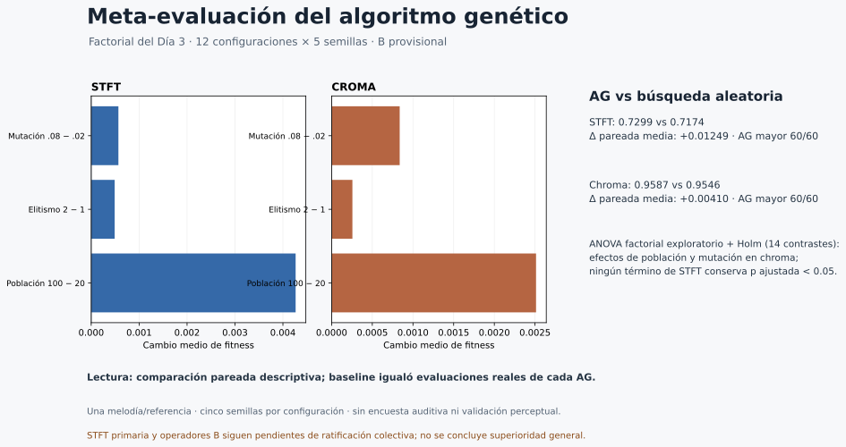

# Lámina Rol 5 — Meta-análisis

**Resultados descriptivos del factorial y baseline pareado del Día 3**  
Datos: una melodía/referencia; 12 configuraciones × 5 semillas, por métrica. Operador B provisional.

| Métrica | Fitness medio AG | Fitness medio aleatorio | Diferencia pareada media | AG mayor |
|---|---:|---:|---:|---:|
| STFT | 0.729882 | 0.717397 | +0.012485 | 60/60 |
| Chroma | 0.958681 | 0.954582 | +0.004099 | 60/60 |

**Lectura:** comparación pareada descriptiva con igual presupuesto real. En el ANOVA factorial exploratorio, con semilla como bloque y Holm para 14 contrastes, población (`p ajustada=1.87×10⁻⁸`) y mutación (`0.00587`) mostraron efectos en chroma; ningún término de STFT conservó `p ajustada < 0.05`. No se demuestra superioridad general ni calidad perceptual; no se comprobaron supuestos de residuos.

**Pendiente de equipo:** ratificar STFT como métrica primaria y B como operadores. La encuesta auditiva ciega no está realizada; los datos cubren una melodía/referencia y cinco semillas por configuración.

**Demo:** notebook `notebooks/05_rol5_metaevaluacion.ipynb`; no ejecuta nuevas corridas. La lámina se entrega en SVG editable/importable; este entorno no dispone de un creador de PPTX y no se instaló ninguno.

## Figuras complementarias y entrega grupal

- Boxplot de resultados guardados por método: [STFT](../../resultados/rol5/dia4_metaevaluacion/boxplot_corridas_stft.svg) y [chroma](../../resultados/rol5/dia4_metaevaluacion/boxplot_corridas_croma.svg). Cada gráfico agrupa 60 observaciones de 12 configuraciones × cinco semillas.
- [Tornado de sensibilidad de hiperparámetros](../../resultados/rol5/dia4_metaevaluacion/tornado_hiperparametros.svg): población, elitismo y probabilidad de mutación; se distingue de la sensibilidad de genes del Rol 1.
- No se localizó una presentación grupal editable. `rol4_convergencia.pptx` corresponde a Rol 4; se requiere que el equipo proporcione el deck grupal para integrar esta lámina. Este archivo SVG y sus figuras son entregables individuales del Rol 5.
