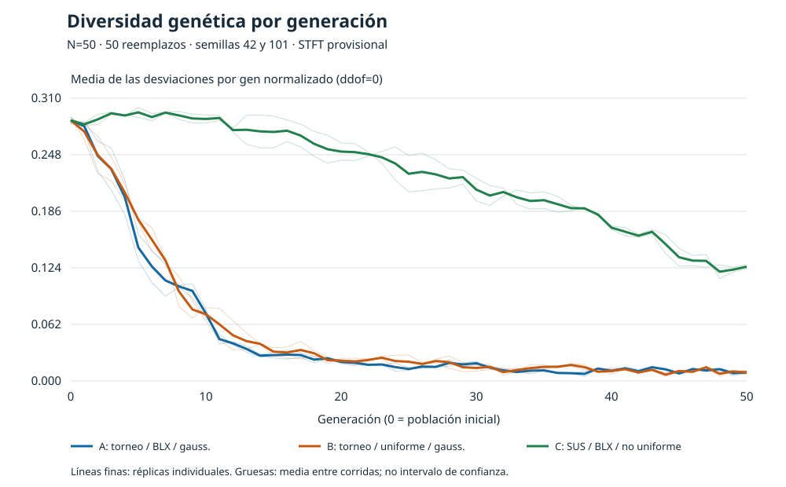
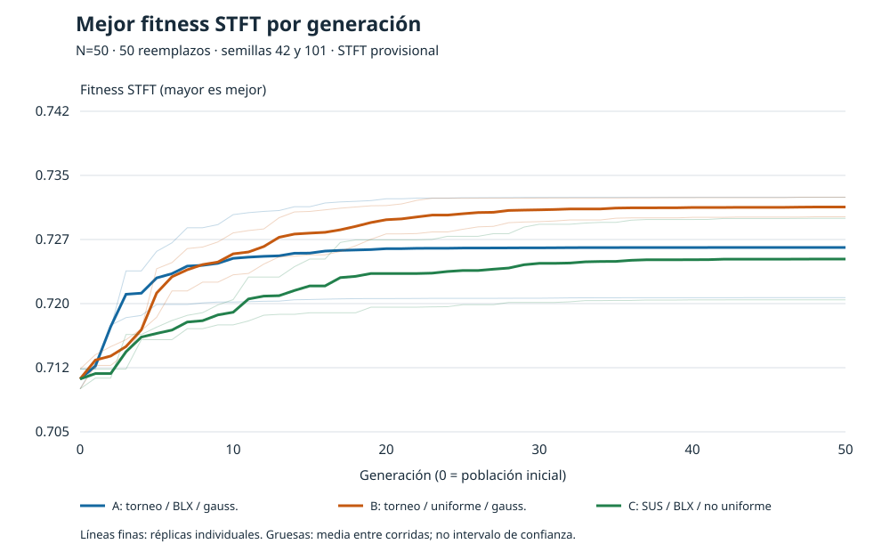

# Rol 3 — Día 3: comparación reducida

**Recomendación preliminar: B, torneo + uniforme + gaussiana.** Es la mayor media entre las tres combinaciones con las semillas 42 y 101; no demuestra superioridad general.

## Estado y protocolo

Rama `feature/rol3-comparacion-dia3`, base `64617f8aaa3dcbed3332a1bcb16291c5efd8481e`, actualizada mediante fetch. Cambios locales sin commit, push ni merge. El ciclo del Rol 4 `c52281a` está integrado mediante `ae86d4e` (PR #13). El Rol 2 `10f7643` está integrado mediante PR #15; su recomendación de STFT continúa siendo provisional.

El examen pide tres combinaciones, tabla, diversidad por generación y análisis de exploración/explotación. N=50, 50 reemplazos y el presupuesto igual son el protocolo solicitado para esta tarea, no requisitos atribuidos al examen. El protocolo inicial de cinco semillas fue reducido por instrucción del usuario. Se eligen **42 y 101 por ser las primeras dos semillas completas en el orden previsto**, sin seleccionarlas por su resultado.

- A: torneo + BLX-alpha + gaussiana; B: torneo + uniforme + gaussiana; C: SUS + BLX-alpha + no uniforme.
- N=50, elitismo=2, torneo k=3, p_cruce=0.90 por pareja, p_mut=0.05 por gen, máscara uniforme=0.50; alpha=0.5, sigma=0.08, b=2.0.
- 50 reemplazos más generación 0: **2550 llamadas reales por corrida**, incluidas las élites reevaluadas. Las seis corridas principales suman 15300 evaluaciones y terminaron por max_generaciones.
- Se usó tolerancia_mejora=0 para desactivar estancamiento mediante la interfaz existente; difiere del valor base 1e-4, sin cambiar los predeterminados del Rol 4. Paciencia=10.
- Se capturaron los primeros 50 cromosomas efectivamente evaluados y se contrastaron con un generador independiente. Para cada semilla, las tres poblaciones iniciales son idénticas. Los sorteos posteriores pueden diferir.
- STFT a maximizar, **provisional, sin ratificación colectiva**. Croma no se combinó ni se usó para ordenar. Semilla de síntesis independiente=2026.

La carga reutiliza los dos arreglos retornados por cargar_melodia_csv(). Se comprobó el WAV existente mono PCM16, 22050 Hz, 59645 muestras, coincidencia de notas/duraciones con JSON, fronteras y silencios. No se regeneraron datos. N_FFT=2048, salto=256, Hann, piso=-80 dB, amplitud de referencia=1, boundary=zeros y padded=True; fitness=1/(1+error_dB/10). Las huellas SHA-256 del CSV, WAV y JSON, versiones, configuración y código ejecutado están en `manifiesto.json`.

## Comparación principal: dos réplicas por combinación

DE = desviación estándar muestral entre corridas (ddof=1). La media corresponde al mejor fitness final de cada corrida, no al fitness medio poblacional.

| Combinación | n | Media | DE | Mediana | Mínimo | Máximo |
|---|---:|---:|---:|---:|---:|---:|
| B | 2 | 0.730850220 | 0.001608342 | 0.730850220 | 0.729712951 | 0.731987489 |
| A | 2 | 0.726136022 | 0.008259060 | 0.726136022 | 0.720295984 | 0.731976059 |
| C | 2 | 0.724787225 | 0.006706397 | 0.724787225 | 0.720045087 | 0.729529364 |

| Combinación | Evaluaciones media ± DE | Tiempo s media ± DE | Diversidad final media ± DE |
|---|---:|---:|---:|
| B | 2550 ± 0 | 54.126 ± 1.338 | 0.009313 ± 0.003768 |
| A | 2550 ± 0 | 55.477 ± 2.956 | 0.009409 ± 0.001390 |
| C | 2550 ± 0 | 55.171 ± 6.280 | 0.125190 ± 0.003304 |

| Semilla | A | B | C | B−A | B−C |
|---|---:|---:|---:|---:|---:|
| 42 | 0.731976059 | 0.729712951 | 0.729529364 | -0.002263108 | +0.000183587 |
| 101 | 0.720295984 | 0.731987489 | 0.720045087 | +0.011691505 | +0.011942402 |

## Diversidad e interpretación





Las figuras usan solo las seis corridas principales, con dos líneas finas por combinación y una media gruesa. No son intervalos de confianza; no se rellenan historiales. La diversidad es mean(std(P,axis=0,ddof=0)) sobre genes normalizados.

La diversidad inicial media fue 0.285487 en las tres combinaciones. A y B terminaron cerca de 0.0094, mientras C conservó 0.125190 y obtuvo menor fitness medio. En estas corridas, A/B concentraron la población más intensamente; C mantuvo mayor dispersión sin mejorar el resultado final. Esto es compatible con distinta presión de explotación, pero no prueba que mayor diversidad sea mejor ni permite atribuir el resultado de C a SUS o a la mutación por separado.

A–B cambia solo el cruce. BLX puede explorar fuera del intervalo parental antes del recorte; uniforme recombina valores existentes. La gaussiana introduce perturbaciones y la no uniforme reduce el desplazamiento con el tiempo. Son mecanismos interpretativos; aquí no se aislaron todos sus efectos.

B supera la media de A por 0.004714198 y la de C por 0.006062995. Sin embargo, **A gana en la semilla 42 y B en la 101**. Con dos réplicas, la variabilidad se estima con mucha incertidumbre. La recomendación de B es preliminar y limitada a estas condiciones. Se ordenó por media sin redondear; el desempate previsto era menor DE y luego menor tiempo, pero no fue necesario. El tiempo es de pared, bajo carga del equipo, no un benchmark aislado.

## Resultados adicionales conservados

No participan en tablas principales, figuras ni recomendación. Se conservan los cinco checkpoints adicionales y `corridas_adicionales.csv`:

| Combinación | Semilla | Mejor fitness | Evaluaciones |
|---|---:|---:|---:|
| A | 2024 | 0.731977016 | 2550 |
| A | 7 | 0.731992916 | 2550 |
| B | 2024 | 0.729558007 | 2550 |
| B | 7 | 0.728696352 | 2550 |
| C | 2024 | 0.728573635 | 2550 |

Hay **11 corridas con checkpoint válido** (28050 evaluaciones registradas): seis principales y cinco adicionales. La corrida B/7 que estaba en curso terminó y quedó guardada. El bucle automático llegó a iniciar C/7 antes de detenerse; su guardado falló por el bloqueo temporal colocado en el destino para detener el lote. No existe checkpoint válido de C/7: se conserva el registro de fallo, no se incluye y no se repite. No se iniciaron corridas de semilla 999. El total de 28050 excluye el trabajo no registrado de C/7 y las 45 evaluaciones de la comprobación corta.

## Uso recomendado para el Rol 4

```python
from src.algoritmo_genetico import ejecutar_ag
from src.configuracion import ConfiguracionAG
from src.fitness import evaluar_individuo
from src.comparacion_operadores import cargar_datos

notas, duraciones, referencia, _ = cargar_datos()
def aptitud(gen):
    return evaluar_individuo(gen, notas, duraciones, referencia, metrica="stft")

config = ConfiguracionAG(
    tam_poblacion=50, max_generaciones=50, elitismo=2, tam_torneo=3,
    probabilidad_cruce=0.90, probabilidad_mutacion=0.05,
    paciencia_estancamiento=10, tolerancia_mejora=0.0, semilla=42,
)
resultado = ejecutar_ag(
    aptitud, config, seleccion="torneo", cruce="uniforme",
    mutacion="gaussiana", alpha=0.5, sigma=0.08, b=2.0,
)
```

Esta llamada documenta la configuración; no se ejecuta al visualizar los resultados. No se cambian los valores predeterminados del Rol 4.

## Archivos, verificaciones y limitaciones

Se reutilizaron ciclo, operadores, síntesis y fitness sin cambios. El registro y resumen reutilizan funciones del Rol 5. `corridas.csv`, `historial.csv` y `resumen.csv` contienen solo las seis corridas principales; `ganadores.csv` conserva los once ganadores. El manifiesto original de 15 corridas se conserva como protocolo inicial; `cierre_reducido.json` documenta el cambio de alcance. `fuente_ejecucion_original.py` conserva el código cuya huella figura en ese manifiesto; el módulo actual solo permite consultar y rechaza reanudar el lote.

Antes de reducir el alcance se ejecutó la comprobación corta (tres variantes, 15 evaluaciones cada una), separada de los resultados. En la suite existente pasaron 51 pruebas; un módulo de sensibilidad del Rol 1 no cargó por falta de pandas. Los errores de permisos temporales se resolvieron al repetir fuera del sandbox. No se agregaron ni ejecutaron nuevas pruebas después de la reducción. Las comprobaciones existentes de lectura verificaron los seis checkpoints, parámetros, semillas, finitud y conteo/historial.

Faltan pandas, Matplotlib, IPython, nbformat, nbclient e ipykernel en el entorno. Las corridas se ejecutaron en un proceso Python, no en un kernel Jupyter. El notebook conserva el Día 2 y se amplió para leer estos resultados, pero no se ejecutó en esta etapa. Las figuras SVG se generaron con biblioteca estándar. No se instalaron dependencias.

Dos réplicas, una melodía y una referencia no permiten afirmar significación estadística, robustez general ni superioridad perceptual. STFT sigue provisional. No se ejecutaron el factorial, el baseline ni evaluaciones auditivas. El experimento está detenido por instrucción del usuario; no se completará automáticamente el protocolo inicial.
